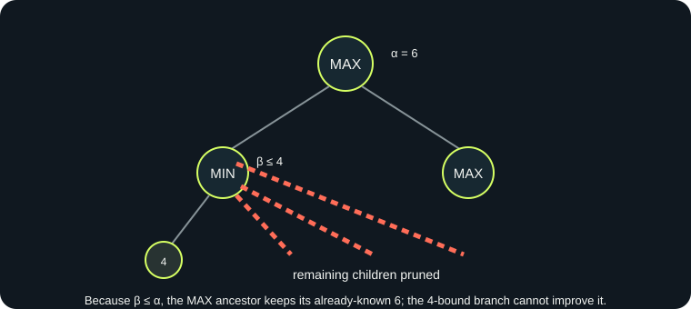

# Minimax and Alpha-Beta in FOURWARD

## Intuition

Minimax imagines that both sides choose moves well: the AI picks the continuation with the highest score, while the human picks the continuation with the lowest score. A depth limit ends the search; the evaluator estimates the position at that horizon. Alpha-Beta keeps the same decision rule but stops considering a branch when an ancestor already has a choice at least as good.

## Formal model

The state is a 6×7 matrix with `0` empty, `1` human, and `2` AI. A legal action is a non-full column. The transition drops a token to the lowest empty row. Terminal utility is ±100000 adjusted by ply distance so wins are preferred sooner and losses delayed. At a depth cutoff, the heuristic scores central occupancy and uncontested four-cell windows. It is an estimate, not a proof of eventual outcome.

## Pseudocode

```text
MINIMAX(state, depth, maximizing):
  if terminal: return terminal utility
  if depth = 0: return heuristic(state)
  if maximizing: return max(MINIMAX(child, depth-1, false))
  else:          return min(MINIMAX(child, depth-1, true))

ALPHA_BETA(state, depth, alpha, beta, maximizing):
  if terminal or depth = 0: return evaluation
  for child in deterministic center-first order:
    value = ALPHA_BETA(child, depth-1, alpha, beta, !maximizing)
    update max/min value and alpha/beta
    if alpha >= beta: count cutoff; stop this node's siblings
  return value
```

For the AI's root candidate display, each candidate is searched with a full `[-∞,+∞]` window so every displayed score is exact at the configured horizon.

## Worked pruning fragment

Suppose a maximizing root already has an option worth 6, so α=6. At another minimizing node, its first child scores 4, setting β=4. Since β≤α, the minimizing player can already force a result no better than 4 in that subtree. The maximizing root will choose its existing 6 option, so later children under this minimizing node cannot affect the root decision and are skipped.



## Complexity and metrics

With branching factor `b` and depth `d`, plain Minimax explores O(b^d) positions. Alpha-Beta's worst case is still O(b^d); ideal ordering can approach O(b^(d/2)). Connect Four's available moves vary by state, so these are asymptotic bounds rather than observed timings. FOURWARD records entered nodes, evaluated leaves, terminal leaves, cutoff events, considered edges, maximum reached ply, and measured search duration. The trace retains at most 120 cutoff events; the lab shows the latest 12 with actual ply, node type, column, bounds, and siblings skipped. Move ordering changes efficiency, not the minimax value.

## Common mistakes avoided

- Terminal checks precede the depth horizon.
- Hypothetical moves are undone in `finally` blocks.
- Minimax and Alpha-Beta share the same evaluator and ordering.
- Alpha-Beta cutoffs are not counted as exact values for skipped individual candidates; root candidate scores use full windows.
- Search does not mutate the match board after completion.

## References

- Knuth, D. E., & Moore, R. W. (1975). An analysis of alpha-beta pruning. *Artificial Intelligence, 6*(4), 293–326. https://doi.org/10.1016/0004-3702(75)90019-3
- Russell, S., & Norvig, P. (2021). *Artificial Intelligence: A Modern Approach* (4th ed.). Pearson. ISBN 9780137505135.
- Allis, V. (1988). A knowledge-based approach of Connect-Four: The game is solved: White wins. *ICGA Journal, 11*(4), 165. https://doi.org/10.3233/ICG-1988-11410
