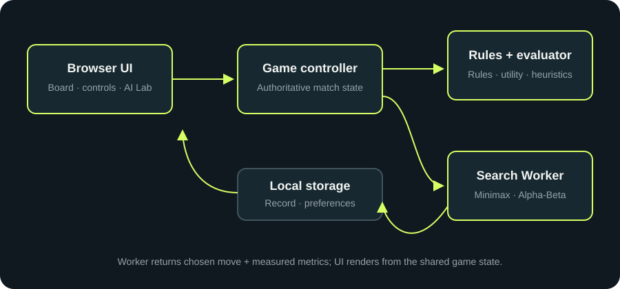
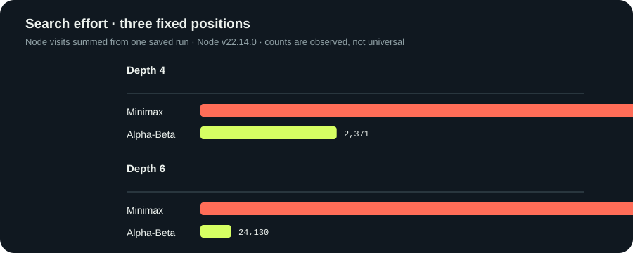

# FOURWARD — Project report draft

## Abstract

FOURWARD is a browser-based Connect Four implementation designed to demonstrate adversarial search. It pairs a modular rule engine with Minimax and Alpha-Beta pruning, then exposes search instrumentation in a player-facing analysis panel.

## Problem formulation

Connect Four is a deterministic, two-player, zero-sum, turn-taking game. A state is a 6×7 board, actions are legal columns, and transitions obey gravity. Four equal non-empty cells in a horizontal, vertical, or diagonal window make a terminal win; a full board without a win is a draw. AI maximizes utility and human minimizes it.

## Theoretical background

Minimax and adversarial game search are covered in Russell and Norvig's *Artificial Intelligence: A Modern Approach* (4th ed., 2021). Knuth and Moore's 1975 analysis formalizes Alpha-Beta pruning and its correctness. Allis's 1988 work describes a solution of Connect Four; FOURWARD's bounded heuristic opponent is an educational search agent, not an implementation of that solved strategy.

## Design and implementation

The rule/search core is separated from DOM code. The search uses a bounded horizon, terminal scores favoring faster wins, a center-weighted window heuristic, deterministic center-first move order, and counters from actual recursion. The AI Lab compares controlled searches against the exact same position and depth.

## Algorithm design

The search checks for a win and draw before applying the depth cutoff. At AI nodes, it maximizes the returned score; at human nodes, it minimizes. Non-terminal cutoff positions use a heuristic that rewards central AI occupancy and windows with AI pieces and no human piece, while penalizing windows threatened by the human. The move order is `[3, 2, 4, 1, 5, 0, 6]`. Alpha-Beta tracks lower and upper bounds and stops sibling exploration when `alpha >= beta`. The game UI sends a copied position to a module Worker, which returns the selected column, candidate scores, and search metrics.

## Experimental methodology

The included Node benchmark fixes three legal move sequences and runs both methods at depths four and six using the same evaluator and center-first ordering. The script records one timing per search. The saved data identifies the execution timestamp, depth, algorithm, selected move, utility, entered nodes, leaves, terminal positions, cutoff events, move edges, reached ply, and duration. Because this is one run with three positions and a single runtime/device, duration should be treated as an observation; repeat measurements on a documented environment before making broader claims.

## Evaluation

One benchmark run is preserved in [`benchmark-results.json`](benchmark-results.json). The raw file includes UTC timestamp and environment (Node version, Windows platform, architecture, CPU model, and logical-core count). At depth 4, Minimax/Alpha-Beta node counts for positions 1–3 were 2,758/701, 2,786/695, and 2,415/975. At depth 6, they were 129,490/5,455, 130,814/6,261, and 97,456/12,414. For all six controlled comparisons the selected move and root score matched. In aggregate at depth 6 these positions visited 357,760 Minimax nodes and 24,130 Alpha-Beta nodes. This is one run of three selected positions; the saved timing observations are specific to this environment and do not establish a universal runtime improvement.

| Position | Depth | Minimax nodes | Alpha-Beta nodes | Minimax score / move | Alpha-Beta score / move |
|---:|---:|---:|---:|---:|---:|
| 1 | 4 | 2,758 | 701 | -7 / 4 | -7 / 4 |
| 2 | 4 | 2,786 | 695 | 67 / 4 | 67 / 4 |
| 3 | 4 | 2,415 | 975 | -85 / 1 | -85 / 1 |
| 1 | 6 | 129,490 | 5,455 | -26 / 4 | -26 / 4 |
| 2 | 6 | 130,814 | 6,261 | 63 / 4 | 63 / 4 |
| 3 | 6 | 97,456 | 12,414 | -161 / 1 | -161 / 1 |

The result supports score and move agreement for these fixed-depth cases. It does not imply equal performance on every position or depth.

Automated core checks are defined in `tests/run-tests.js`; run `npm test` to reproduce them.

## Limitations

The heuristic is approximate, browser/device timing varies, and the search depth is intentionally bounded. Search uses a Web Worker where available but falls back to synchronous execution in older browsers. The AI Lab has no dynamic full-tree renderer; it shows actual root scores and a bounded cutoff trace. No experiment chart generator or automated browser test suite is included.

## Conclusion

FOURWARD demonstrates Connect Four state transitions and classical adversarial search in a self-contained browser interface. Its comparison mode and saved benchmark output make the difference in explored nodes inspectable. The current implementation establishes correctness on the included targeted core tests and a browser smoke check; broader browser, device, accessibility, and tournament evaluation remains future work.

## References

See [Algorithm Explanation — References](ALGORITHM_EXPLANATION.md#references) for publication details and DOI/ISBN links. This project's opponent is finite-depth Minimax and is not the game-theoretic solver described by Allis.
